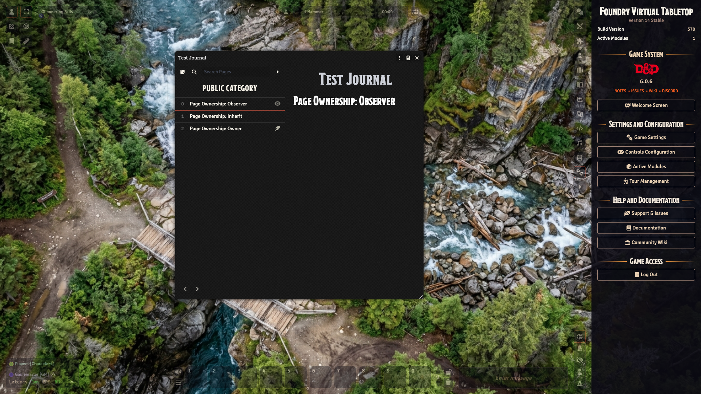
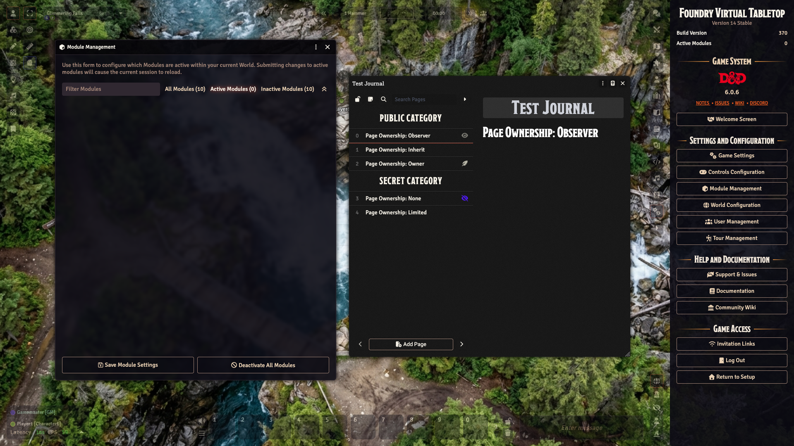
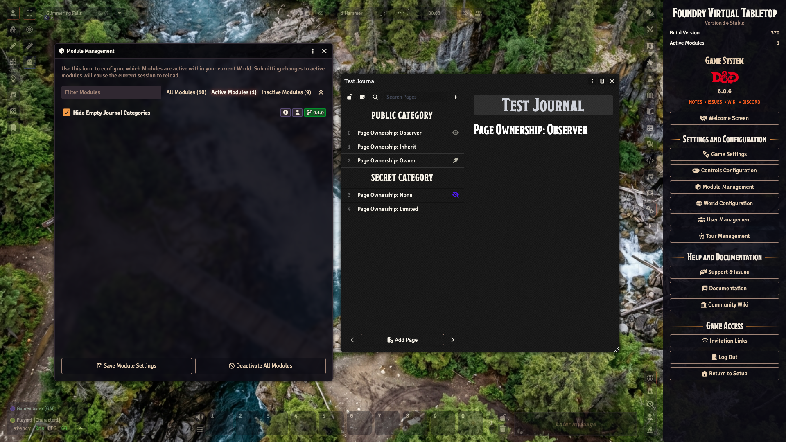

# Hide Empty Journal Categories

A small Foundry Virtual Tabletop module that hides journal categories from
players when none of their pages is visible to them.

Without it, players see every category header in a journal entry, even when
the GM has hidden all the pages under it.

## Behavior

- In the journal's table of contents, players see a category only when at
  least one of its pages is visible to them.
- Users who can edit the journal entry, such as the GM, still see every
  category, so they can keep track of the empty ones.
- Category names are still part of the journal data each client receives, and
  a player who owns a page can still pick from every category when editing
  that page.

## Screenshots

|        | Without the module                                                       | With the module                                                    |
| ------ | ------------------------------------------------------------------------ | ------------------------------------------------------------------ |
| Player |  |  |
| GM     |          |          |

## Installation

In Foundry's Add-on Modules tab, choose `Install Module` and paste the manifest
URL for the version you want.

### Latest Version

To install the latest version, paste this one:

```text
https://github.com/AlanGabbianelli/fvtt-hide-empty-journal-categories/releases/latest/download/module.json
```

### Specific Version

To install a specific version, paste that version's URL, for example this one
for v0.1.0:

```text
https://github.com/AlanGabbianelli/fvtt-hide-empty-journal-categories/releases/download/v0.1.0/module.json
```

## Compatibility

Foundry Virtual Tabletop v14.
